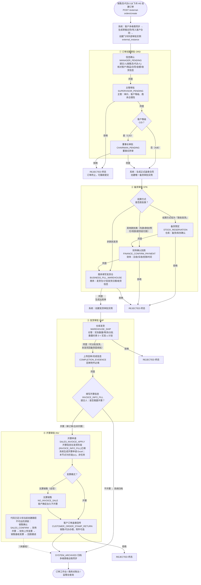
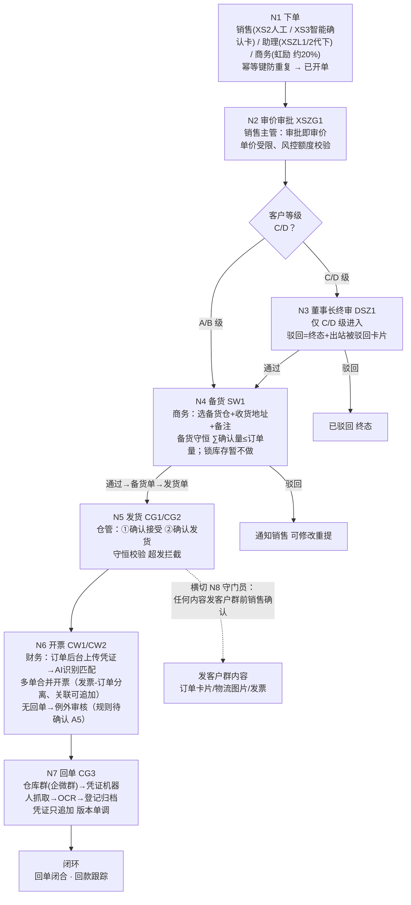
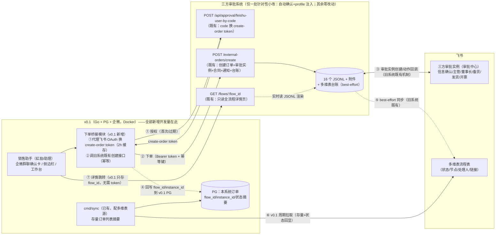

# 三方审批（现状） vs b2b_pilot_v3 v0.1：业务流程对比与数据同步设计

> 生成日期：2026-08-18
> 依据：`tripartite-approval` 代码（Node/TS + JSONL + 飞书三方审批）与文档；`b2b_pilot_v3/docs/v0.1/*`（11 章）、`docs/gap-analysis.md`、`spec/`（T1.1-T1.3、RHCRM 数据源架构、字段映射、缺陷汇总）与 `migrations/`。
> 用途：① 产出与 v0.1 可对比的三方审批业务主流程图；② 支撑"v0.1 销售助手下单、后续业务流继续在飞书三方审批上跑"的决策与节奏设计；③ 梳理数据兼容/同步的必要性与补漏清单。

---

## 0. 结论摘要（TL;DR）

1. **业务语义高度同构**：两套流程都是「下单 → 审价 → 终审(C/D) → 备货 → 发货 → 开票/回单 → 归档」，节点可一一映射（`gap-analysis.md §2` 已有术语映射：ORD=已开单、STK=已备货、SHP=已发货、INV=已开票）。
2. **结构性差异集中在 4 处**：① 审价节点归属（旧系统在订单创建阶段内 3 步审批 vs v0.1 独立 N2 审价节点）；② 备货阶段多了「财务确认到款」闸门（款到类结算方式的订单）；③ 开票阶段节点数（旧系统 8 个节点、其中 5 个深链节点当前不可达，实际生产只跑"盖章回传→归档"或"无票销售→归档"；v0.1 单节点+例外审核）；④ 回单/凭证的位置与载体（旧系统在发货阶段上传回单、v0.1 在 N7 仓库群机器人）。
3. **方向性差异（最关键）**：v0.1 原设计是**平行流**——「飞书 → v0.1 单向只读同步，商务在 v0.1 里操作备货/发货/开票，0.1 不回写飞书」（`11-migration.html §1`）。而你要的「v0.1 销售助手下单、**后续业务流仍在飞书三方审批跑**」是**相反方向**：v0.1 必须能把订单**写进**旧系统/飞书流。现有 v0.1 设计**没有这条写路径**，需要新增；开发量边界（用户已确认）：**为上线新增的一切开发量归 v0.1**，旧系统**仅一处针对性小改**（§5.1 边界 1：幂等键前缀识别 v0.1 订单 → 自动确认信息确认 + V01 profile 注入），其余零改动、只使用其既有接口/页面/数据（见 §6、附录 C 决策 D1/D3）。
4. **数据兼容结论**：**不需要**把旧系统 JSONL 迁入 PG 才能上线。需要做的是三件事，**全部是 v0.1 侧开发量**：① 写方向：v0.1 代理飞书 OAuth，用旧系统**既有** `/api/approval/feishu-user-by-code` 换 create-order token，调**既有** `POST /external-orders/create` 创建订单；② 读方向：自建单列表直查 v0.1 PG（下单回写），存量订单列表用 v0.1 现有 `cmd/sync` 的**多维表 http 源**（无需旧系统任何导出能力）；③ 5 项状态语义差异先拍板（T1.3 §5 未对口径项，见 §4.2；仅影响状态回显的映射，不阻塞下单）。
5. **上线节奏**：v0.1 作为「下单入口 + 订单列表/状态视图」，飞书流全权续跑，销售助手获得完整体验闭环（下单→飞书审批→状态回显→驳回重提）。按「调研冻结 → v0.1 桥接模块开发（代理 OAuth + 调用既有接口）→ 同步配置 → 联调 → 虹励一人灰度（体验清单验收）→ 上线」推进，与现有 11-migration 的 P0-P4 计划对齐即可，关键路径仍是企微备案域名（见 §7）。
6. **最终目标（用户确认）**：**以企微版流程取代飞书三方审批流**——v0.1–v0.4 逐版迁移办理动作（v0.1 入口/视图 → v0.2 备货 → v0.3 发货/财务 → v0.4 销售环节），0.5 完成主管/董事长两级终审迁入与真相源切换后，飞书三方审批流整体下线（历史只读归档 + 观察期回滚通道）。完整路线见 `docs/渐进式发布计划.html`（附录 C D10）。

---

## 1. 图一：三方审批现状业务主流程（代码级）

> 依据：`src/services/submitExternalOrder.ts`、`src/services/stockPrepareApproval.ts`、`src/services/shipmentApproval.ts`、`src/services/invoiceApproval.ts`、`src/routes/feishuActionCallback.ts`、`src/routes/wecomProductionBridge.ts`（nodeLabel/activeNodes 是节点全集）、`README.md`、`FEISHU_THIRD_PARTY_APPROVAL_MANUAL_20260521_0848.md`、`PROJECT_HANDOFF_SNAPSHOT_20260613_1406.md`。

**节点全集（代码事实，`wecomProductionBridge.ts:162-183`）：**

| 阶段 | 节点 ID | 节点名 | 办理角色 | 关键约束/动作 |
| --- | --- | --- | --- | --- |
| ORD | MANAGER_PENDING | 信息确认 | 提交人（销售员/代办人） | 核对数据；同意→主管审批 |
| ORD | SUPERVISOR_PENDING | 主管审批 | 主管 | 审价；同意→按客户等级分支；拒绝→终态 |
| ORD | CHAIRMAN_PENDING | 董事长审批 | 董事长 | 仅 C/D 级客户进入；同意→生成正式合同+创建备货 |
| STK | STOCK_RESERVATION | 备货预定 | 仓库 | 仅当结算方式**恰为"款到发货"**时先走（`stockPrepareApproval.ts:464-466`） |
| STK | FINANCE_CONFIRM_PAYMENT | 财务确认到款 | 财务 | 应收/实收/到账时间；结算方式匹配 `款到发货|先款|款到|预付|现款|提货前付款` 即进入（`stockPrepareApproval.ts:459-462`） |
| STK | BUSINESS_FILL_WAREHOUSE | 商务填写发货仓 | 商务 | 发货仓/计划发货日期/收货信息；通过→生成出库单 |
| SHP | WAREHOUSE_SHIP | 仓库发货 | 仓管 | 实发数量>0 且≤计划；支持分批 |
| SHP | COMPLETION_EVIDENCE | 上传回单/完成信息 | 回单办理人 | 回单附件必填 |
| SHP | INVOICE_INFO_FILL | 填写开票信息 | 提交人 | 是否开票 / 单订单 / 合并开票 / 无票销售 |
| INV | SALES_INVOICE_APPLY | 开票申请 | 提交人（抄送） | 系统生成开票申请 Excel；**本节点是抄送而非办理任务**（`invoiceApproval.ts:592-593,686-687`） |
| INV | NO_INVOICE_SALE | 无票销售 | 无票销售办理人 | 客户确定永久不开票；办理（多人会签）后**仍进入客户订单盖章回传**，再归档（`invoiceApproval.ts:999-1013`） |
| INV | CUSTOMER_ORDER_STAMP_RETURN | 客户订单盖章回传 | 销售/代办 | **开票实例的首个办理任务**；附件可选；通过后实例直接归档（`invoiceApproval.ts:998-1016,1148,1415-1427`） |
| INV | SALES_CONFIRM / FINANCE_ISSUE_INVOICE / FINANCE_UPLOAD_INVOICE / SALES_RECEIVE_INVOICE / SALES_COLLECTION_FOLLOWUP | 销售确认→财务开票→财务上传发票→销售接收发票→回款跟进 | 销售/财务 | **代码已定义（`invoiceApproval.ts:1018-1029`）但当前创建路径不产出这些任务，生产不可达**；T1.3/缺陷汇总中"财务上传发票""回款"相关口径以此为准 |
| — | SYSTEM_ARCHIVED / REJECTED / CANCELED | 归档/拒绝/整单撤销 | 系统 | 终态；多维表台账同步 |

**关键机制（决定"最小成本接入"的事实）：**

1. **订单号/主键体系**：`flow_id = SO-YYYYMMDD-XXXX`（贯穿四环节）；`instance_id = <order_id>-<14位时间戳>`；`stage_id = <flow_id>-<STAGE_CODE>-<seq>`（`submitExternalOrder.ts:218-321`）。
2. **全链路由飞书审批回调驱动**：`POST /feishu/approval/action-callback` 接收飞书动作（同意/拒绝/退回/撤回），识别流程类型后推进本地 JSONL 状态、更新飞书实例、best-effort 同步多维表（`feishuActionCallback.ts`；手册 §10）。**没有本地轮询驱动**。
3. **订单创建是幂等的**：`create_idempotency_key`（8-200 字符）+ 内容指纹 `create_fingerprint` + 内存去重 + 文件锁，重复提交返回既有订单（`submitExternalOrder.ts:112-1503`）。
4. **身份与鉴权**：创建页需飞书 OAuth 换取的 HMAC 签名 token（`CREATE_ORDER_AUTH_SECRET`，2h TTL，每次提交重查销售/代办白名单 `sales_person_map.json` / `agent_person_map.json`）；另有机器通道 `x-renheng-wecom-bridge` header（`WECOM_TEST_BRIDGE_SECRET` / `PRODUCTION_ORDER_BRIDGE_SECRET`）——**当前硬编码只允许王杰下单并强制 `approval_profile=WECOM_WANGJIE_TEST`**（`externalOrders.ts:4149-4167`）。
5. **审批人解析**：`data/approval_role_map.json` 按角色 key（TEST_MANAGER/TEST_SUPERVISOR/TEST_CHAIRMAN/TEST_STOCK_FINANCE/TEST_STOCK_BUSINESS/TEST_SHIPMENT_WAREHOUSE/TEST_SHIPMENT_RECEIPT/TEST_INVOICE_APPLY）映射 open_id；提交人与主管同一人时主管自动通过（`submitExternalOrder.ts:1106-1137`）；`approval_profile` 字段已存在（`WECOM_WANGJIE_TEST` / `FEISHU_WANGJIE_TEST` / 空）。注意：`auto_approve`（董事长自动通过）在 `approvalOrSign.ts` 只声明不赋值，**实际不生效**。
6. **董事长触发条件**：`customer_level ∈ {C, D}`（`submitExternalOrder.ts:1537`），与金额无关。
7. **撤回/撤销**：提交人可撤回回创建页修改重提（`/external-orders/:instance_id/cancel`）；整单撤销 `POST /external-orders/:instance_id/full-cancel` 会把订单/备货/发货/开票统一追加 CANCELED（`externalOrders.ts:4820`）。
8. **超时提醒**：除系统归档外任何节点都有超时未处理通知（`shipmentDelayReminder.ts`，`approval_delay_reminders.jsonl`）。
9. **台账**：多维表按 flow_id 建行/更新（`flowBitableSync.ts`），**JSONL 是生产真相，多维表是对账副本**（`spec/飞书侧数据现状清单.html` 结论）。
10. **开票深链现状（重要）**：当前生产创建路径下，开票实例首任务=客户订单盖章回传（无票销售模式下首任务=无票销售办理，多人会签通过后同样进入盖章回传），**盖章回传通过后实例直接归档**；「销售确认→财务开票→财务上传发票→销售接收发票→回款跟进」5 节点在代码中有完整任务定义（`invoiceApproval.ts:1018-1029`）但**创建路径不产出这些任务，实际不可达**（`invoiceApproval.ts:592-593,998-1016,1148,1415-1427`）。任何"财务上传发票/回款跟进"类业务预期都需要先修代码，与 v0.1 决策无关但必须知道。

---

## 2. 图二：v0.1 设计流程（docs/v0.1 已核对流程）

> 依据：`docs/v0.1/05-business-flow.html`（已核对流程，裁决源 ord_fulfill demo）、`01-business-graphs.html`、`gap-analysis.md`。

**v0.1 节点明细：**

| 节点 | 名称 | 角色 | 与三方审批的对应（`gap-analysis.md §2` 术语映射） |
| --- | --- | --- | --- |
| N1 | 下单（人工/智能确认/代下） | 销售/助理/商务 | ORD 创建（信息确认段） |
| N2 | 审价审批 | 销售主管 | ORD 主管审批 |
| N3 | 董事长终审（C/D） | 董事长 | ORD 董事长审批 |
| N4 | 备货（选仓+收货地址） | 商务 | STK 商务填写发货仓（合并了备货预定/到款确认） |
| N5 | 发货（两步确认） | 仓管 | SHP 仓库发货（多了"确认接受"一步） |
| N6 | 开票（凭证+合并开票） | 财务 | INV 开票申请→…→财务上传发票（压缩） |
| N7 | 回单（仓库群→机器人） | 仓管/系统 | SHP 上传回单（载体不同） |
| — | 守门员横切 | 销售 | 无对应（新能力，发群前确认） |
| — | 闭环：回款跟踪 | — | INV 回款跟进 |

**v0.1 状态机（`01-business-graphs.html` §2）**：已开单 → 待审价 → 待终审(C/D) / 待备货(A/B 或终审通过) → 已备货 → 待发货 → 已发货 → 待开票 → 已开票；异常终态：已驳回、待补回单。
**v0.1 事件图谱（append-only）**：OrderRequested → PriceReviewed → ChairmanReviewed → StockAssigned → WarehouseConfirmed → GoodsShipped → ReceiptRegistered → InvoiceApplied → InvoiceLinked → InvoiceIssued / ReceiptException。

---

## 3. 同构对比：逐节点映射表

| 业务步骤 | 三方审批（飞书，现状） | v0.1 设计 | 差异性质 |
| --- | --- | --- | --- |
| 下单入口 | 飞书 H5 创建页（销售员/代办人） | 企微群侧边栏/确认卡/工作台/群入口（销售/助理/商务多方分担） | **平台差异**（飞书 vs 企微）；角色覆盖不同（A7） |
| 信息确认 | 独立节点 MANAGER_PENDING（提交人核对） | 并入 N1 下单提交 | 节点合并 |
| 审价 | ORD 主管审批（SUPERVISOR_PENDING） | N2 独立审价节点 | 语义一致（审批即审价），**位置相同** |
| 终审 | ORD 董事长审批（C/D 触发） | N3 董事长终审（C/D 触发） | **语义一致**（gap-analysis §2：C/D 订单终审 DSZ1） |
| 合同 | 草稿合同→审批通过后生成正式盖章合同；客户合同优先 | 合同自动匹配（HT-2025-0038） | 旧系统合同链更重（生成/盖章/回传） |
| 备货预定/库存确认 | STOCK_RESERVATION 节点 | 无（锁库存暂不做，A1） | 旧系统多一闸门（0.1 裁剪） |
| 财务确认到款 | FINANCE_CONFIRM_PAYMENT（款到发货类必走） | 无独立节点（账期字段在表单；回款跟踪在闭环） | **结构性差异**：旧系统把"到款确认"做成审批闸门，v0.1 只在闭环跟踪 |
| 商务备货 | BUSINESS_FILL_WAREHOUSE（选仓/计划发货日期/收货信息） | N4 选备货仓+收货地址 | 语义一致（v0.1 多了收货地址字段、少了计划发货日期？） |
| 出库单 | 商务通过后系统生成出库单 | 备货通过后生成备货单/发货单 | 一致 |
| 发货 | WAREHOUSE_SHIP（数量约束+分批） | N5 两步确认（接受→发货，超发拦截） | v0.1 多了"确认接受"步；约束语义一致（守恒） |
| 回单 | COMPLETION_EVIDENCE（发货阶段，附件必填） | N7 仓库群→凭证机器人 OCR（独立环节） | **载体差异**（人工上传 vs 群机器人抓取） |
| 开票信息 | INVOICE_INFO_FILL（发货阶段填，含合并开票/无票分支） | 并入 N6 财务凭证上传 | 旧系统开票信息前置到发货阶段由提交人填 |
| 开票申请 | SALES_INVOICE_APPLY（生成 Excel，抄送） | 无独立节点 | 节点裁剪 |
| 盖章回传 | CUSTOMER_ORDER_STAMP_RETURN（可选附件） | 无（销售合同回传走凭证机器人） | 节点裁剪 |
| 销售确认 | SALES_CONFIRM（**当前不可达**） | N6 财务确认关联订单（合并开票） | 语义近似（确认环节都在） |
| 财务开票/上传发票 | FINANCE_ISSUE_INVOICE → FINANCE_UPLOAD_INVOICE（**当前不可达**） | N6 财务上传凭证（AI 识别） | 旧系统 2 节点 vs v0.1 1 节点（但旧系统实际未接线） |
| 销售接收发票 | SALES_RECEIVE_INVOICE（**当前不可达**） | 无 | 节点裁剪 |
| 回款跟进 | SALES_COLLECTION_FOLLOWUP（**当前不可达**） | 闭环回款跟踪 | 语义一致（但旧系统实际未接线） |
| 无票销售 | NO_INVOICE_SALE 分支 | 无对应（账期/结算表单区分） | 旧系统显式分支 |
| 无回单开票 | 无（回单卡在发货阶段，必须上传才能继续） | CW2 例外审核（5 天无回单自动进/提前申请，规则待确认 A5） | **结构性差异**：v0.1 允许例外开票 |
| 发群通知 | 无（系统通知在飞书侧） | N8 守门员横切（发客户群前销售确认） | **全新能力**（v0.1 独有） |
| 归档 | SYSTEM_ARCHIVED + 多维表台账 | 闭环（回单闭合+回款跟踪） | 语义一致 |
| 撤回/重提 | 提交人撤回→修改→再次提交（RESUBMIT 链） | 驳回→修改重提 | 旧系统有完整 resubmit 链（root/revision），v0.1 简化 |
| 整单撤销 | full-cancel 四环节统一 CANCELED | 无对应（缺陷汇总 M7：作废发货待确认） | 旧系统能力更多 |
| 超时提醒 | 全节点超时通知（24h/48h） | N2 超时 Timer 催办（24h 提醒/48h 升级） | 旧系统全节点覆盖，v0.1 仅审价 |

---

## 4. 差异分析（决策视角）

### 4.1 结构差异 → 对"下单进飞书流"的影响

- 上述差异中，**与下单本身相关的只有入口/平台差异**（飞书 H5 vs 企微助手）。一旦订单在 v0.1 创建并桥接进旧系统，后续审价/终审/备货/发货/开票的**差异全部由飞书流现有实现承担**，v0.1 无需关心。
- 因此对「v0.1 只做下单入口」的目标而言，**业务差异不构成阻塞**；真正要处理的是 **v0.1 下单表单字段 ↔ 旧系统 SubmitOrderInput 的映射**（见 §6.2）。

### 4.2 状态语义差异（T1.3 未对口径的 5 项，上线前必须拍板）

`spec/T1.3-状态枚举语义映射设计.html` 已给出旧系统 169 枚举 → 新系统 34 状态 + 4 FSM 的映射表，但标注 5 项待对口径：

1. **订单已撤回/作废（CANCELED）**：v0.1 ORD 无取消终态，用 ORD_REJECTED 兜底 or 新增 CANCELLED？
2. **发货单已取消/已驳回**：SHP 无取消/驳回态。
3. **待上传回单位置**：旧系统回单在 SHP 段（RECEIPT_PENDING），T1.3 建议回单不独立成状态（receipt.go 分流 HAVE_RECEIPT/RECEIPT_EXCEPTION）。
4. **发货环节是否保留开票信息填写**（旧系统 INVOICE_INFO_FILL 在 SHP 段，T1.3 建议移 INV 段）。
5. **待客户盖章回传（STAMP_RETURN_PENDING）**：代码有 CUSTOMER_ORDER_STAMP_RETURN 节点，T1.3 曾认为代码无此节点——**以代码为准：节点存在且附件可选**（`invoiceApproval.ts:593-681`）。

> 提醒：这 5 项不拍板，`cmd/sync` 的状态映射配置（T1.3 表）就无法冻结；但只要 v0.1 只做"下单+视图"，可先用「旧系统原始状态直存 payload + 视图层粗粒度映射」过渡（见 §6.3）。

### 4.3 数据与平台差异

| 维度 | 三方审批（现状） | v0.1 | 影响 |
| --- | --- | --- | --- |
| 数据真相 | 16 个 JSONL 追加文件（115,690 行/179MB，`飞书侧数据现状清单.html`） | PG 31 表（事件链 append-only） | 同步必须按"快照链取末条"规则 |
| 主数据 | 客户/商品在多维表格（客户池 2,387 条等），本地 contacts xlsx 辅助 | pgAPI（RHCRM PG：客户池 3,217/产品 306，D-006） | 下单字段的客户/商品来源要对齐（见 §6.2-5） |
| 订单汇聚 | 飞书三方审批流程表（1,316 行，对账源）→ rhcrm_contract_sync.py → RHCRM 购销合同表（**唯一订单源**，8,784 单，D-007） | pgAPI 读合同表可见（已裁决只读） | 写方向必须绕开合同表（合同表是结果不是审批入口） |
| 审批载体 | 飞书三方审批 external_instance（审批中心待办） | v0.1 自带 approval_tasks 视图（Signal 人工闸门） | 目标模型下 v0.1 不承载审批，approval_tasks 只作同步视图 |
| 身份 | 飞书 open_id/user_id（open_id 跨应用不通用） | 企微 user_id + SpiceDB | open_id 映射表（T1.2 G3）+ 审批人 assignee 映射调研（T3） |
| 部署 | Windows Server + Node/Express，公网 101.37.66.110:3000 | Docker + Go + PG + Temporal + SpiceDB + 企微 | 网络拓扑：v0.1→旧系统公网可达即可（旧系统→v0.1 回调用公网域名） |
| 金额 | 元（JSONL amount/unit_price） | 分（*_cents） | 桥接与同步都要显式换算（C8） |

### 4.4 对上线节奏的含义

- 旧系统已有已知缺陷（`spec/业务缺陷合并汇总.html`：22 高/48 中/12 低），其中最相关的：**回款金额不参与业务判断、修改订单服务端不重判、48h 升级链未接线**。这些缺陷在"飞书流续跑"模型下**继续存在但不新增暴露面**——v0.1 下单只新增"创建"入口，不触碰修改/回款逻辑。
- 结论：**"v0.1 下单 + 飞书流续跑"比 v0.1 原"平行流"（商务在 v0.1 操作备货/发货/开票）更稳**：因为原平行流要求商务操作与飞书流并行执行同一批节点（双执行，一致性靠单向同步兜底），而"下单+续跑"模型下旧系统是唯一执行者，不存在双执行一致性问题。

---

## 5. 目标模型：v0.1 下单 + 飞书流续跑（图三）

**原则**：① 旧系统（飞书流）在迁移期是状态机执行者，**仅两处针对性小改**（§5.1 边界 1 的 v0.1 改动 + v0.2 起的受信办理通道），其余零改动——v0.1 只调用其既有接口、只跳转其既有页面；② 为上线新增的一切开发量（OAuth 代理、token 缓存、下单桥接、同步配置、列表/视图、跳转、v0.2 起的执行迁移）**全部计入 v0.1 侧**；③ v0.1 只做**下单入口 + 订单列表/状态视图**，不并行执行任何审批节点；④ 敏感项（view_token 等）不落 v0.1 PG——详情跳转 `/flows/:flow_id` 无需任何 token（`flows.ts:817-880` 无鉴权只读页），符合 11-migration V4 敏感边界；⑤ **最终目标=以企微版流程取代飞书三方审批流**：v0.2 起按环节渐进迁移办理动作（新系统办理 → 受信通道 → 旧系统状态机推进 + 飞书实例同步），0.5 完成两级终审迁入与真相源切换后飞书整体下线（详见 `docs/渐进式发布计划.html`，附录 C D10）。

### 5.1 审批链路无感续跑（飞书侧视角）——对用户问题的直接确认

**结论：销售主管审批、董事长审批、以及后续备货/发货/开票审批，在飞书侧完全无感**——它们与飞书 H5 下单的订单走同一套机制，审批人感知不到订单来自 v0.1（企微）。

**机制证据（代码级）：**

1. **订单创建 = 同一入口**：v0.1 调 `POST /external-orders/create` → `submitExternalOrderFromFormSync` → `createExternalInstance`（同一 `FEISHU_APPROVAL_CODE`、同一外部审批实例机制）→ 审批机器人消息卡片 + 飞书审批中心待办（`submitExternalOrder.ts:2177+`）。
2. **审批人解析 = 同一 role map**：`data/approval_role_map.json`（TEST_MANAGER/TEST_SUPERVISOR/TEST_CHAIRMAN/TEST_STOCK_*/TEST_SHIPMENT_*/TEST_INVOICE_*）决定审批人，与下单渠道无关。
3. **后续节点自动推进**：审批动作 → `action-callback` → 本地 JSONL 状态推进 → 自动创建备货/发货/开票审批实例（`feishuActionCallback.ts`）——飞书侧闭环，v0.1 全程不介入。
4. **审批表单无渠道痕迹**：external instance 的 i18n 字段只有订单号/主流程编号/客户/销售员/代办人/提交人/商品/金额/结算方式/收货/合同链接/审批指引；orders.jsonl 的 `source` 固定为 `"external-orders-create-form"`；不带桥接头时 `approval_profile` 为空——**没有任何"企微/v0.1"来源标识会出现在审批页**。
5. **身份链路透明**：企微 user_id 只在 v0.1 内部标识授权人；落到旧系统与飞书的身份 = OAuth 换到的飞书 open_id/user_id（旧系统 app 域内）——审批人看到的是标准飞书身份。

**三个"有感觉"的边界（必须知晓，均非缺陷）：**

| # | 边界 | 说明 | 处置（已确认） |
| --- | --- | --- | --- |
| 1 | **信息确认节点由提交人办理** | 销售助手下单后（若本人为提交人），需在飞书审批中心点一次「信息确认」——飞书 H5 下单的销售员同样如此，是旧流程既有第一步；代下单时提交人=代办人，则由代办人（如虹励）确认 | **已决策：采用旧系统针对性小改**（用户 2026-08-18 确认，范围收敛、质量可控优先；附录 C D3）。**为什么必须旧系统改、v0.1 侧做不了**（排除论证）：办理需 `approver_token`（=JSONL 中的 `manager_approver_view_token`），而该 token ① 下单响应不返回、② 多维表链接只有 `/flows/:flow_id` 不带 token（`flowBitableSync.ts:1013`）、③ 详情页办理表单只在 `canOperate`（审批人视角）渲染，submitter 视角拿不到（`externalOrders.ts:3565`）；伪造 action-callback 需 `FEISHU_ACTION_CALLBACK_TOKEN`（v0.1 不知，且违反审计原则，禁止）。**改动三点**（集中在 `submitExternalOrder.ts` 订单创建处 + `approval_role_map.json` 配置）：① **识别**：`create_idempotency_key` 带 v0.1 前缀（如 `order:chang-an:v01:`）即视为 v0.1 订单；② **自动确认**：外部实例创建成功后，由旧系统内部直接调用既有 decision 核心函数（APPROVE + manager task + 意见"系统自动确认（v0.1 提交人）"，entry=approval_center 语义），复用既有状态机/事件链/飞书实例更新/消息路径——审计等价于提交人本人办理；③ **profile 注入**（必须一并做）：v0.1 订单自动注入专用 `approval_profile`（如 `V01_SALES_ASSISTANT`），在 `approval_role_map.json` 的 `approval_profiles`（机制已存在，`approvalOrSign.ts:79-96`）下配置**真实业务审批人**——使虹励的单与默认映射（王杰）彻底解耦（附录 D）。风险控制：条件=幂等键前缀只影响 v0.1 订单；改动单一文件；先在独立测试服务验证再上生产 |
| 2 | **审批人 = 当前角色映射（程序员把王杰配置进了不该进的角色）** | 生产 `approval_role_map.json` 默认 roles 中：主管审批 fallback 到 TEST_MANAGER=王杰、董事长审批（C/D 级）fallback 到王杰、财务/开票 or-sign 组含王杰（审计明细见**附录 D**） | **已决策：默认映射完全不理会、保持原样**（不修不改，现状如何就是如何；附录 C D6）。**背景事实（用户确认）**：王杰/王鑫力是程序员、不负责任何业务、**不会点审批**（审批映射中实际只有王杰，王鑫力不在审批映射）；张有连=**董事长**（其订单自动跳过主管审批=正确业务，勿动勿改，`submitExternalOrder.ts:1129`）。**唯一前置（必须做）**：V01 profile 注入时**必须在 `approval_profiles` 里显式配置 `TEST_SUPERVISOR`（建议同时配 `TEST_CHAIRMAN`）为真实主管/董事长**——因为 profile 覆盖是 **merge 而非替换**（`approvalOrSign.ts:79-96`：`roles: {...baseRoles, ...profileRoles}`），若 V01 profile 不配 TEST_SUPERVISOR，主管审批仍会 fallback 到默认 TEST_MANAGER=王杰。备货财务/开票申请（base=王杰 或签 李丽姣）与商务/仓管/回单（base 已含虹励 or-sign 组）可不配，按需补齐即可。**接受现状的边界**：现有生产订单在主管/董事长节点是否卡单 = 旧系统现状问题，v0.1 上线不改变它、也不归 v0.1 管；查 `orders.jsonl` 滞留单仅为知情项（可选），不构成上线阻塞 |
| 3 | **驳回/重提在 v0.1 操作** | 驳回后销售助手在 v0.1 看原因、复制重提（reuse-data） | **已确认：其它用户（飞书 H5 下单）零影响**。驳回订单在旧系统所有既有视图照常可见：订单工作台按归属人过滤且状态体系完整包含 REJECTED/CANCELED（`orderWorkbench.ts:95-190`）、审批中心"已办"、详情页（submitter_token）、对账台/监管台——与今天完全一致。v0.1 对旧系统的全部影响面仅：① 多一个下单入口（新增订单记录）；② cmd/sync 只读拉取多维表（无写）；③ 授权回调白名单加 v0.1 地址（只增不减）；④ 白名单追加虹励。**提醒**：cmd/sync 按流程表拉全量会把其它用户的订单也同步进 v0.1 PG（只读视图）——v0.1 工作台默认只显示"我创建/我代下的单"（PG 直查），"全部订单"视图按角色权限（SpiceDB）控制可见性 |

**一句话**：审批人（主管/董事长/财务/仓管）在飞书里看到的是标准「销售订单创建/备货/发货/开票」待办，渠道透明、零感知。已决策的旧系统针对性小改（幂等键前缀识别 v0.1 订单 → 自动确认信息确认 + 注入 `V01_SALES_ASSISTANT` profile 映射真实审批人）让虹励在企微端完全无感，且与默认映射（王杰/王鑫力）解耦；该小改只影响 v0.1 订单，不影响飞书 H5 用户。上线前需现场查证生产 role map 实际内容与现有滞留单（边界 2），以判断现状是否已存在卡单。

---

## 6. 数据兼容与同步设计

### 6.1 现状盘点（数据面清单）

| 数据面 | 位置/形态 | 角色 |
| --- | --- | --- |
| 旧系统业务真相 | `tripartite-approval/data/*.jsonl`（16 个文件，字段见 `spec/biz/飞书三方审批系统存储表及字段说明.md`） | **唯一权威**：orders/stock_prepares/shipments/invoices + 事件表 |
| 飞书审批实例 | 飞书开放平台 external_instance（approval_code 配置） | 审批中心待办/已办载体；`external_instances.jsonl` 是本地索引 |
| 多维表格台账 | app_token BWJpbO0eoaGk6AsSSDUcbUJIndd（三方审批流程表 tbllXhLTHwsoWIbG 1,316 行 / 明细表 tblXQ0DcNvKS43VB 1,116 行 / 客户档案 tbl7paPnZGiTTpSn 2,387 行） | 对账副本，**非真相** |
| RHCRM 购销合同表 | PG（rhcrm_contract_sync.py 已从流程表同步，44 字段映射，8,784 单） | **唯一订单源**（D-007 已裁：v0.1 只读可见，写路径 OI-016 后置） |
| v0.1 PG | 31 张表（001-007 迁移） | 流程引擎数据 + 同步视图 |

### 6.2 写方向：v0.1 下单 → 飞书流（需要新增，本设计的核心）

**方案对比（开发量边界：除标注"旧系统代码"外，全部计入 v0.1 开发量）：**

| 方案 | 做法 | 旧系统代码 | v0.1 开发量 | 风险 | 结论 |
| --- | --- | --- | --- | --- | --- |
| **A1. 代理 OAuth（推荐）** | v0.1 跳飞书授权（旧系统 app）→ code 交旧系统**既有** `/api/approval/feishu-user-by-code` 换 create-order token（2h，v0.1 缓存加密）→ 调**既有** `POST /external-orders/create` 下单 | **零** | 中（OAuth 代理 + token 缓存 + 调用器 + 回写） | token 2h 过期需重新授权（跳转一次）；授权回调地址需加入旧系统飞书应用重定向白名单（配置，非代码） | ✅ 0.1 采用 |
| A2. 桥接泛化 | 旧系统新增"桥接 secret 换 token/豁免 token"端点 | **需旧系统开发** | 低 | 动旧系统代码+生产部署 | ⏳ 0.2 再说（不占 0.1 开发量） |
| B. JSONL 直写 | v0.1 直接把订单写进旧系统 `data/orders.jsonl` | 零 | 看似低 | 绕过文件锁/幂等/合同生成/审批实例创建逻辑，**极高**（会制造半成品订单） | ❌ 禁止 |
| C. v0.1 直接调飞书 API 建审批实例 | v0.1 自己创建 external instance | 零 | 中 | 与旧系统 external_instances 索引、回调路由、JSONL 状态脱节；两套真相 | ❌ 不推荐 |
| D. 写 RHCRM 合同表 | v0.1 调 `POST /api/db/purchase-contracts` | 零 | 低 | 合同表是**结果**不是审批入口，写了不触发飞书审批；且 D-007 已裁写路径后置 | ❌ 0.1 不做 |

**A1 落地细节（全部 v0.1 侧实现）：**

*v0.1 新增「下单桥接模块」（建议 `internal/bridge` 或 `cmd/bridge`）：*

1. **OAuth 代理**：v0.1 构造飞书授权 URL（用旧系统 `FEISHU_APP_ID`，redirect_uri 指向 v0.1 回调端点）→ 销售助手首次/过期时点一次"飞书授权"→ 飞书回调 v0.1 → v0.1 拿 code 调旧系统**既有** `POST /api/approval/feishu-user-by-code`（`approvalFlowConfig.ts:257-336`）→ 返回 create-order token + 用户身份（open_id/user_id/role）。token 按用户加密缓存（2h TTL，过期前 15 分钟提示重授权）；同时把 open_id/user_id 落 v0.1 身份映射表（企微 user_id ↔ 飞书 user_id，T1.2 G3 缺口由本模块顺带补上）。
2. **下单调用器**：把销售助手表单映射为 `SubmitOrderInput`（字段对照见下），生成幂等键 `order:<tenant>:<source>:<uuid>`（v0.1 既有规范）直接作为旧系统 `create_idempotency_key`；带 `Authorization: Bearer <create-order token>` 调 `POST /external-orders/create`（multipart 字段，`externalOrders.ts:4120-4520`）；成功后回写 `flow_id`/`instance_id`/`stage_id`/`detail_url` 到 v0.1 PG（orders.legacy_flow_id 已有字段 + `UNIQUE(tenant_id,legacy_flow_id)` 约束）；失败按旧系统错误码分类（FEISHU_AUTH_EXPIRED / SERVICE_MISCONFIGURED / ORDER_DATA_INVALID 等，`externalOrders.ts:612-671`）转人。
   - 注意：**不带** `x-renheng-wecom-bridge` 桥接头（该头强制王杰+测试 profile）；普通 Bearer 调用走默认角色解析，`approval_profile` 为空——数据仍进同一批 JSONL，以 instance_id/flow_id 区分。
   - 提交人语义：授权人 role=sales → 只能本人下单；role=agent → 以本人为代办人、可选归属销售（`externalOrders.ts:4174-4226` 的 identityMatches 校验）。销售助手（虹励/助理）建议加入旧系统 `agent_person_map.json` 白名单（数据配置，非代码），即可代下单；若在 sales 白名单则只能以本人销售身份下单。
3. **字段映射**（旧 `SubmitOrderInput` ← v0.1 表单）：
   - 客户：老客户传 `customer_record_id`（v0.1 侧必须是 pgAPI 客户 record_id，旧系统用它同步多维表客户池）；新客户传名称/税号/等级/供方等字段，由旧系统回写客户池。
   - 商品明细：`items[]`（product_name/quantity/unit_price/total/packaging/package_spec/arrival_date/remark）→ 旧系统自动做产品规格补全。
   - 结算：`payment_terms`（旧系统判定：`款到发货|先款|款到|预付|现款|提货前付款` 为款到类，`stockPrepareApproval.ts:459-462`）+ `remittance_method`。**提醒：v0.1 表单的"账期 30 天/月结 30 天"（demo）必须映射为旧系统可识别的结算方式文本**（最容易被忽略的字段级差异，直接决定备货阶段是否走财务确认到款闸门）。
   - 收货：`shipping_address/receiver/phone/is_self_pickup/pickup_warehouse`。
   - 合同：0.1 阶段建议**不传客户合同文件**（旧系统自动生成草稿合同，审批通过后生成盖章版）；若必须支持合同附件，走 multipart 上传（`validateOrderCreateUpload`），注意旧系统 `.doc` 转换依赖 LibreOffice。
   - 金额单位：v0.1 内部用分，桥接时换算为元（旧系统 amount/unit_price 是元）。
4. **复制/重提**（体验增强，P1）：调旧系统既有 `GET /external-orders/:instance_id/reuse-data?submitter_token=...`（`externalOrders.ts:4567`）取可复用数据预填表单；注意 `submitter_view_token` **不落 v0.1 PG**（V4 敏感边界），仅在用户会话内持有或现场引导重新授权后取回。

*旧系统侧非开发配合（均为配置/数据操作，不写代码）：*

5. 旧系统飞书应用后台：把 v0.1 授权回调地址加入"安全设置-重定向 URL"白名单（一次配置）。
6. 旧系统 `data/agent_person_map.json`（或 sales_person_map.json）加入销售助手（虹励等）身份（数据文件配置，README 红线：追加式修改、先备份）。
7. **审批人映射（已审计，勿按旧手册操作）**：生产 `data/approval_role_map.json` 默认 roles 已被审计（附录 D）——**决策：默认映射完全不理会、保持原样**（不修不改）；销售助手的订单走 `V01_SALES_ASSISTANT` profile（§5.1 边界 1 ③，merge 语义下**必须显式配置 TEST_SUPERVISOR/TEST_CHAIRMAN**，附录 D-4），不需要改默认 roles。
8. 若需要"销售助手下单、主管自动通过"（虹励=提交人且=主管映射人）——旧系统既有逻辑会自动通过（`submitExternalOrder.ts:1106-1137`），确认是否期望行为。

### 6.3 读方向：飞书流 → v0.1（全部 v0.1 侧实现，不依赖旧系统新能力）

目标分层（按"销售助手体验"拆解，控制开发量）：

1. **自建订单列表（P0，零同步开发）**：v0.1 下过的单天然在 v0.1 PG（桥接回写 flow_id/instance_id/状态摘要）——工作台"我创建的订单"直接查 PG，**不需要任何同步**。
2. **存量订单列表（P1）**：v0.1 现有 `cmd/sync`（`internal/sync/sync.go` 已实现 http 拉取器 + MapRow + SanitizeRow + migration_batches 幂等）配置**多维表 http 源**即可——旧系统下单后 best-effort 同步多维表流程表（tbllXhLTHwsoWIbG，含流程状态/当前环节/当前节点/当前处理人/金额/链接，手册 §11），v0.1 周期拉取（先 1h 起步，跑稳缩短）。**不需要旧系统任何导出端点**。前置：v0.1 飞书应用有 bitable 读权限（T3.1 调研项）。
3. **订单详情（P0，零开发）**：v0.1 详情页"查看完整流程"直接跳旧系统**既有** `GET /flows/:flow_id`（`flows.ts:817-880`，无鉴权只读页，实时读 JSONL 渲染四环节快照+事件时间线+评论）。v0.1 只需存 flow_id，**不落任何 token**（符合 11-migration V4：view_token 不迁 PG）。
4. **实时性**：审批进度以飞书审批中心（原生待办/已办）+ flows 页（实时）为准；v0.1 列表状态为周期回显（多维表源）。不指望旧系统 webhook（零改动）；若 T3 调研确认 v0.1 飞书应用可读审批实例 API，可作为增强源（实时节点级状态）。
5. **状态映射**：列表回显的状态用 T1.3 映射表（旧 169 枚举 → 34 状态）；**5 项未对口径项未拍板前**，v0.1 列表先展示"旧系统原始 status/status_label + 当前节点"（多维表流程表直接有中文状态/节点字段），不阻塞上线（T1.3 拍板只影响 v0.1 侧状态映射代码，与旧系统无关）。
6. **敏感边界**（`11-migration §6` 已定）：open_id 映射内部 user_id（加密映射表）；view_token 不进 PG；列表/详情不落审批表单原始 JSON。

### 6.4 兼容性检查清单（补漏）

上线前逐项核对（P0=必须、P1=建议、P2=可后置）：

| # | 检查项 | 级别 | 说明 |
| --- | --- | --- | --- |
| 1 | 存量订单可见性 | P1 | 经 cmd/sync 多维表源同步列表摘要（流程表 1,316 行）；自建单直查 v0.1 PG，不依赖存量同步也能开工 |
| 2 | 审批中订单 | P0 | 同步/拉取不影响飞书侧审批（只读调用）；飞书原流程冒烟照常（V5） |
| 3 | 撤回/驳回/撤销单 | P0 | CANCELED/REJECTED 单在 v0.1 列表正确显示（多维表流程状态 + T1.3 映射；未拍板前先显示原始状态/节点） |
| 4 | 身份映射 | P0 | OAuth 代理时绑定企微 user_id ↔ 飞书 user_id/open_id（v0.1 侧映射表，T1.2 G3）；旧系统白名单（agent/sales_person_map.json）须含销售助手（数据配置） |
| 5 | 结算方式枚举对齐 | P0 | demo"账期 30 天/月结 30 天" → 旧系统"款到发货/先款/款到/预付/现款/提货前付款"判定（决定财务闸门是否触发） |
| 6 | 金额单位换算 | P0 | 分 ↔ 元（C8）；桥接与同步双向显式换算 |
| 7 | 幂等 | P0 | v0.1 幂等键 `order:<tenant>:<source>:<uuid>` 直接作为旧系统 create_idempotency_key；重试安全；旧系统已有 `/external-orders/submission-status` 可查提交结果 |
| 8 | 附件/文件 | P1 | 0.1 阶段销售助手可不传合同（旧系统自动生成草稿合同）；存量附件经 flows 页/多维表链接查看，不迁移文件本体 |
| 9 | 分批/合并开票单 | P1 | 列表状态回显即可；不进入 v0.1 操作链（飞书跑） |
| 10 | 网络拓扑 | P0 | v0.1 → 旧系统公网 URL（101.37.66.110:3000 或内网）与飞书 API；**不需要**旧系统 → v0.1 方向（零 webhook） |
| 11 | 时区/时间语义 | P1 | 多维表/JSONL 时间均为旧系统时区语义；v0.1 展示层统一转换 |
| 12 | 监控对账 | P1 | v0.1 自建单 vs 多维表状态分布每日对账（V2）；同步批次失败告警+连续 N 次停止人工介入 |
| 13 | 数据区分 | P0 | v0.1 订单与旧系统既有数据共存于同一 JSONL 存储（approval_profile 字段区分，**不按 profile 隔离存储**——A 报告确认）；v0.1 侧以 flow_id/instance_id 维度过滤自己的订单，排查/回滚都按 flow_id 定位 |
| 14 | 回滚 | P0 | v0.1 侧关闭桥接开关即停用下单（旧系统零改动零回滚）；同步 Job 可停 |
| 15 | 旧系统缺陷规避 | P1 | 回款金额不参与判断、修改订单不重判等缺陷（22 高）在目标模型下不新增暴露面；销售助手**不提供修改/撤销**能力，规避修改类缺陷 |
| 16 | 审批人同人自动通过 | P1 | 虹励若同时是提交人与审批角色（TEST_* 映射同一人），主管自动通过逻辑会生效（submitExternalOrder.ts:1106）——确认这是期望行为 |
| 17 | 飞书应用配置 | P0 | 旧系统飞书应用后台：v0.1 授权回调地址加入重定向白名单（配置，非代码） |
| 18 | 授权体验 | P1 | create-order token 2h 过期：v0.1 缓存+过期前提醒；"我的订单"页放"重新授权"入口（一次跳转） |

### 6.5 风险与红线

- **红线（沿用旧系统 README）**：不清空/覆盖 `data/*.jsonl`；测试服务不得读写生产 data 目录；桥接 secret 不进 Git；生产修复保留前后证据。
- **风险 1**：旧系统 `POST /external-orders/create` 是浏览器表单接口（multipart），v0.1 以代理 OAuth 的 Bearer token 调用——若 v0.1 高并发下单，需确认旧系统单进程锁/幂等能扛住（file lock + 内存去重已实现，销售助手单人场景量级小无碍）。
- **风险 2**：企微备案域名未就绪 → 销售助手群聊入口不可用（现有 11-migration 已知风险）；备用：PC 订单后台/侧边栏走通数据线。
- **风险 3**：`spec` 调研 T3（审批流部署形态、webhook 可行性）未完成前，实时性按轮询兜底设计，不阻塞。
- **风险 4**：旧系统开票阶段 8 个节点中 4 个是"销售/代办"角色节点（盖章回传/确认/接收/回款跟进）——销售助手下单后，这些节点的处理人仍是飞书侧的销售员，v0.1 不代做；需在业务上确认销售员会继续用飞书办理（即"后续业务流在飞书跑"的完整含义）。
- **风险 5（现状事实，非 v0.1 引入）**：开票深链「财务开票→上传发票→接收→回款跟进」在旧系统**当前不可达**（见 §1 机制 10）——生产开票实际止于"盖章回传→归档"。若业务方期望这些环节真实生效（如财务上传发票、回款跟进的审批），需在旧系统单独排期修复（把深链任务接入创建路径），**不要**把这部分期望算进 v0.1 上线范围。
- **风险 6（流程小修）**：发布过程中主要流程不变、允许小修（节点增删/字段调整/顺序微调），优先在飞书端临时性修补（飞书是执行真相）；受信办理通道按 task_id 粒度天然兼容节点级小修；**唯一硬约束：0.5 真相源切换前流程必须冻结**（业务修正暂停），否则切换时流程仍在变会造成映射错乱（附录 C D13）。

### 6.6 执行迁移通道（v0.2 起）·受信办理 —— 已验证成立

> v0.2 起，环节办理动作从飞书迁入新系统：新系统办理 → 受信端点 → 旧系统 decision 核心 → 状态机推进 + 飞书实例同步显示已办。本节为受信通道的代码级事实与必须堵上的点（完整验证见 `docs/发布计划可行性验证.md`）。

**已验证的代码事实（无鉴权死路）：**

| 环节 | decision 鉴权 | 文件上传 | 证据 |
| --- | --- | --- | --- |
| 订单 | approver_token + task_id + entry=approval_center 免身份 | 无 | `externalOrders.ts:4965-5007` |
| 备货 | **仅 approver_token 匹配** | 无（字段型 extraData） | `stockPrepares.ts:963-977` |
| 发货 | 仅 approver_token 匹配 | receipt_files 必传（回单节点） | `shipments.ts:1853-1871,1954` |
| 开票 | 仅 approver_token 匹配 | invoice_files | `invoices.ts:772-789` |

**两个需临时修补的缺陷（旧系统临时性修补，很小）：**

1. **operatorOpenId 是占位符**（`"(stock-prepare-web-approver)"` 等）——审计「谁办的」不精确；受信端点传真实办理人（新系统用户身份）。
2. **无并发锁**（对比订单的 `activeOrderDecisionKeys`）——受信端点加幂等锁，防双通道并发办理（新系统 + 飞书残留待办）。

**必须堵上的点（P0，执行迁移的安全前提）：**

| # | 时点 | 必须堵上 |
| --- | --- | --- |
| P0-2 | v0.2 前 | 存量待办规则：迁移开关只对新单生效（按 flow_id 批次），存量单飞书走完 |
| P0-3 | v0.2 前 | 受信端点 + 并发锁 + 真实办理人 |
| P0-4 | v0.3 前 | 开票迁移按真实任务定义（「开票申请」是抄送非任务、财务深链不可达）→ v0.3 迁「确认到款」+「盖章回传」 |
| P0-5 | v0.3 前 | 受信通道文件转发（multipart 直传）+ 附件归属定稿 |
| P0-6 | v0.4 前 | 新系统详情页 + 附件查看自立（0.5 后旧系统若停机，flows 页不可依赖） |
| P0-7 | 0.5 前 | T1.3 五项目拍板（新系统状态机接住所有中间状态） |
| P0-8 | 0.5 前 | JSONL 级全量迁移（含事件链）+ 真相源切换仪式（冻结写→对账→切换）+ 切换/回滚演练 |

---

## 7. 上线节奏建议

> 与 `11-migration.html` 的 P0-P4 计划对齐，新增"桥接"工作线。目标：**本周（08-21 窗口）内，v0.1 提供销售助手下单 + 订单状态视图，飞书流不停**。

| 阶段 | 工作内容（全部 v0.1 开发量） | 依赖/前置 | 验收标准 |
| --- | --- | --- | --- |
| S0 调研冻结（已大部完成） | T1.1 存储结构 ✅；T1.2 字段映射 ✅；T1.3 状态映射 ✅（5 项拍板）；T3 飞书应用权限/审批流部署调研 | — | 5 项状态差异拍板记录；T3 调研产出归档；旧系统白名单/角色映射确认单 |
| S1 桥接与旧系统小改 | ① v0.1 桥接模块（OAuth 代理 + token 缓存 + 下单调用器 + 字段映射 + 幂等 + 回写 PG，§6.2）；② **旧系统针对性小改**（幂等键前缀识别 → 自动确认信息确认 + `V01_SALES_ASSISTANT` profile 注入，§5.1 边界 1；独立测试服务验证） | S0、旧系统飞书应用重定向白名单配置 | 联调：测试账号经 OAuth 授权→下单成功→**信息确认自动通过**→主管/董事长审批推到真实审批人（profile 映射）→飞书审批中心可见→v0.1 PG 有 flow_id/instance_id |
| S2 列表与视图（v0.1） | 自建单列表（PG 直查）；存量单 cmd/sync 多维表源配置；详情跳转 flows 页 | S1 | 10 笔测试单（新老客户/款到非款到/自提）全链路可见；存量订单列表出现 |
| S3 体验增强（P1） | 复制/重提（reuse-data）；重新授权入口；驳回原因展示 | S1+S2 | 体验清单 6 项（§8）通过 |
| S4 灰度 | 仅虹励一人；真实下单 1-2 笔走全流程 | S1+S2 | 销售助手体验闭环验收（§8 体验清单） |
| S5 上线 | 打开桥接开关；监控/对账告警上线；回滚预案就绪 | S4 | 上线后 3 天观察：下单成功率、审批实例创建成功率、状态回显延迟 |
| 0.2+ | 执行迁移（§6.6 受信办理通道）：v0.2 商务/备货 → v0.3 仓管·财务/发货·开票 → v0.4 销售环节 → 0.5 两级终审迁入 + 真相源切换，飞书三方审批流整体下线（取代完成）。完整路线与 P0 清单见 `docs/渐进式发布计划.html`、`docs/发布计划可行性验证.md` | 0.1 数据验证 | — |

**节奏要点**：
- **关键路径仍是企微备案域名**（销售助手群聊入口）——未就绪则先上 PC 订单后台/侧边栏（现有 P4 备选）。
- **全部开发量在 v0.1 侧**：旧系统**仅一处针对性小改**（§5.1 边界 1：自动确认 + V01 profile 注入，附录 C D3）；其余旧系统侧只有配置/数据操作（飞书重定向白名单、agent/sales 白名单加人、角色映射不理会）。
- 若本周窗口赶不上，**最小可上线切片**是：S1 桥接模块 + S4 灰度先跑通"下单→审批实例→flows 详情查看"，存量订单同步（S2 后半）可后置 1 周——因为销售助手下单后第一时间可在飞书审批中心看到待办（飞书原生体验），v0.1 视图只是增强。

---

## 8. 开发量边界、动作清单与体验闭环验收

### 8.1 开发量边界（已确认原则）

| 工作项 | 归属 | 说明 |
| --- | --- | --- |
| OAuth 代理、token 缓存、下单桥接调用器、字段映射、幂等、回写 PG | **v0.1 开发量** | §6.2 全部实现点 |
| 自建单列表、存量单同步（cmd/sync 多维表源）、详情跳转、复制重提、重新授权入口 | **v0.1 开发量** | §6.3 全部实现点 |
| 旧系统针对性小改（已决策，共两处）：① v0.1 幂等键前缀识别 → 自动确认信息确认 + V01 profile 注入；② v0.2 起受信办理通道（新系统办理 → 旧系统状态机推进 + 飞书实例同步，执行迁移的基础，一次改造四版复用） | **v0.1 主导、旧系统落地**（改动收敛于 `submitExternalOrder.ts` 创建处 + 受信办理端点 + `approval_role_map.json` 的 approval_profiles 配置；独立测试服务验证后上生产） | ① 只影响 v0.1 订单（前缀条件）；② 只受理信凭证调用（非浏览器路径）；默认映射/其它用户零影响 |
| 旧系统其它代码改动（桥接泛化、导出端点、webhook） | **0（不做）** | 0.2 需要时再议，不占 0.1 |
| 旧系统 bug 修复（开票深链、auto_approve、修改校验、回款判断、48h 升级链等） | **0（不做）** | 旧系统程序员职责；v0.1 只规避不触碰（§6.4-15） |
| 旧系统配置/数据操作（飞书重定向白名单、agent/sales 白名单加人、角色映射确认） | **配置操作（非开发）** | 旧系统侧执行，或 v0.1 团队代操作；不写代码 |

### 8.2 动作清单（按阶段）

| 阶段 | 动作 | 责任人 | 产出 |
| --- | --- | --- | --- |
| S0 | 5 项 T1.3 状态口径拍板 | 业务方 | 拍板记录 |
| S0 | 旧系统飞书应用后台加 v0.1 授权回调地址到重定向白名单 | 旧系统侧/管理员 | 配置完成截图 |
| S0 | `agent_person_map.json`（或 sales_person_map.json）加入销售助手；`approval_role_map.json` 角色映射确认 | 旧系统侧/管理员 | 白名单与映射确认单 |
| S1 | v0.1 新增 `internal/bridge`：OAuth 代理 + token 缓存 + 下单调用器 + 错误分类 | v0.1 开发 | 联调通过（测试订单→飞书审批实例出现） |
| S1 | 字段映射表落地（§6.2-3 对照表→代码常量表） | v0.1 开发 | 映射单测 |
| S2 | 自建单列表页（PG 直查）+ 存量单 cmd/sync 多维表源配置 + 详情跳转 flows 页 | v0.1 开发 | 10 笔测试单全链路可见 |
| S3 | 复制/重提（reuse-data）、重新授权入口、驳回原因展示 | v0.1 开发（P1） | 体验清单 6 项通过 |
| S4 | 虹励一人灰度，真实下单 1-2 笔 | v0.1 + 虹励 | 体验闭环验收通过 |
| S5 | 开桥接开关、监控对账上线、回滚预案 | v0.1 运维 | 3 天观察报告 |

### 8.3 销售助手体验闭环（0.1 验收定义）

> 用户目标原文：「发 v0.1 版上线，给销售助手这个角色一定的流程体验」。体验闭环按 6 项验收：

| # | 体验项 | 实现载体 | 验收标准 |
| --- | --- | --- | --- |
| 1 | 下单 | 企微入口（群聊确认卡/侧边栏/工作台）→ 提交 | 提交成功提示"已进入审批"；v0.1 记录 flow_id/instance_id |
| 2 | 审批可见 | 飞书审批中心 + 机器人消息卡片（旧系统既有） | 下单后飞书侧出现信息确认待办（提交人=销售助手本人时）或审批人待办 |
| 3 | 进度回显 | v0.1"我的订单"列表（自建单即时；存量单周期） | 列表显示状态/当前节点；点详情跳 `/flows/:flow_id` 看到四环节快照+事件时间线+评论 |
| 4 | 驳回/通过感知 | 列表状态回显 + flows 页审批意见 | 状态变化在周期内回显；驳回原因可见 |
| 5 | 重提/复制 | reuse-data（P1） | 驳回单/已完成单可一键复制再下 |
| 6 | 授权续期 | 过期提醒 + 一键重新授权 | token 过期不再静默失败；跳转一次完成授权 |

### 8.4 明确不做（防范围蔓延）

- 不修旧系统任何 bug / 深链（开票财务链、auto_approve、EMAIL_ARCHIVE 占位等）。
- **旧系统唯一改动**（已决策）= §5.1 边界 1 的针对性小改（自动确认 + profile 注入）；除此之外旧系统零代码改动。
- 不在 v0.1（本期 v0.1）执行备货/发货/开票操作——**执行迁移自 v0.2 起按环节渐进推进**（受信办理通道，见 `docs/渐进式发布计划.html`）；v0.1 阶段飞书流全权续跑。
- 自动下单（会话存档+意图建单）移出一期；锁库存不做。
- 不迁移 JSONL 数据（只做只读同步视图 + 跳转既有页面）。
- 不新增旧系统导出端点 / webhook / 桥接泛化（0.2 再议）。

---

## 附录 A：证据索引（关键文件:行号）

| 事实 | 位置 |
| --- | --- |
| flow_id/instance_id/stage_id 生成 | `tripartite-approval/src/services/submitExternalOrder.ts:218-321` |
| 幂等键/指纹/去重 | 同文件 `:112-1503` |
| 提交人语义（agent>sales）与角色解析 | 同文件 `:1471-1500`、`approvalOrSign.ts` |
| 主管同人自动通过 | 同文件 `:1106-1137` |
| 董事长触发条件 C/D | 同文件 `:1537` |
| 订单持久化与后台任务（CREATE_ORDER_APPROVAL） | 同文件 `:1542-1756`、`backgroundJobs.ts:408/526-528` |
| 创建接口与桥接硬编码 | `src/routes/externalOrders.ts:4120-4167`、`createOrderAuth.ts` |
| 桥接只读接口与 profile 硬编码 | `src/routes/wecomProductionBridge.ts:255-342` |
| 节点全集/标签 | 同文件 `:162-183` |
| 备货节点顺序/款到分支 | `src/services/stockPrepareApproval.ts:459-466,645-667,1070-1320` |
| 发货节点/数量约束 | `src/services/shipmentApproval.ts`（WAREHOUSE_SHIP/COMPLETION_EVIDENCE/INVOICE_INFO_FILL） |
| 开票节点链/无票分支/深链不可达 | `src/services/invoiceApproval.ts:592-593,686-687,998-1031,1075-1148,1415-1427` |
| 回调驱动 | `src/routes/feishuActionCallback.ts` |
| 整单撤销 | `src/routes/externalOrders.ts:4820-4905` |
| 超时提醒 | `src/services/shipmentDelayReminder.ts` |
| 16 表字段清单 | `b2b_pilot_v3/spec/biz/飞书三方审批系统存储表及字段说明.md` |
| 飞书侧数据现状（行数/多维表） | `b2b_pilot_v3/spec/飞书侧数据现状清单.html` |
| 字段映射/缺口 | `b2b_pilot_v3/spec/JSONL与项目数据库字段迁移对位及缺口分析 2.html`、`spec/T1.2-字段映射核对表.html` |
| 状态映射（169→34） | `b2b_pilot_v3/spec/T1.3-状态枚举语义映射设计.html` |
| RHCRM 数据源架构/唯一订单源/D-007 | `b2b_pilot_v3/spec/RHCRM-订单数据源架构说明.html`、`-v0.1影响评估.html` |
| v0.1 业务流程（N1-N8） | `b2b_pilot_v3/docs/v0.1/05-business-flow.html` |
| 平行流/同步方案/敏感边界/V1-V6 | `b2b_pilot_v3/docs/v0.1/11-migration.html` |
| 0.1 范围与裁决原则 | `b2b_pilot_v3/docs/gap-analysis.md`、`README.md` |
| 同步 Job 实现 | `b2b_pilot_v3/cmd/sync/main.go`、`internal/sync/sync.go`、`config/sync.example.json` |

## 附录 B：术语对照表

| 三方审批（旧） | v0.1 | 说明 |
| --- | --- | --- |
| flow_id（SO-YYYYMMDD-XXXX） | orders.legacy_flow_id | 主流程贯穿键 |
| instance_id | legacy_flow_mapping.legacy_instance_id | 各环节审批实例 |
| ORD/STK/SHP/INV | stage_code | 四环节代码一致 |
| status（169 枚举） | state（34 状态） | T1.3 映射 |
| approval_profile | — | 旧系统审批配置隔离；v0.1 桥接使用独立 profile |
| 款到发货/非款到发货 | payment_term（账期 30 天/月结 30 天） | 需枚举对齐 |
| 无票销售 NO_INVOICE_SALE | — | 旧系统显式分支 |
| 合并开票 | invoice_order_links | 旧系统 24 字段，v0.1 独立关联表 |
| external_instance | approval_tasks（视图） | 审批载体 |

## 附录 C：决策记录（2026-08-18，用户确认，勿再推翻）

| # | 决策 | 内容 | 依据/背景 |
| --- | --- | --- | --- |
| D1 | 开发量边界 | 为 v0.1 上线新增的一切 job/同步/开发量 = **v0.1 侧开发量**；旧系统不修 bug、不为其开发 | 用户原话："为了支持我们新系统上线，额外要做的一些 job，同步动作，认为是我们的开发量，而不是旧系统的开发量" |
| D2 | 旧系统改动态度 | 旧系统**可以改，但尽量不改**（质量不太可控） | 用户原话 |
| D3 | 信息确认自动化 | **采用旧系统针对性小改**：幂等键前缀识别 v0.1 订单 → 自动确认信息确认 + 注入 V01 profile（§5.1 边界 1，三点方案） | 用户确认"增加一点特殊的代码，在飞书端，针对这些订单直接自动确认" |
| D4 | v0.1 角色 | 唯一用户=销售助手**虹励**；其它用户（飞书 H5 下单）**零影响、不提供企微入口** | 用户原话 |
| D5 | 驳回/重提体验 | 虹励在企微端看到驳回并重提；其它用户驳回后照旧在飞书端可见（工作台/审批中心/详情页） | 用户确认；`orderWorkbench.ts:95-190` 已含 REJECTED/CANCELED 状态体系 |
| D6 | 默认 role map | **完全不理会、保持原样**（程序员把王杰配置进了不该进的角色，不修不改） | 用户原话："我并不想解决这些问题…现状如何就是如何" |
| D7 | 审批人背景 | 王杰/王鑫力=程序员、不负责任何业务、**不会点审批**；被推送不关心 | 用户确认；审批映射中实际只有王杰（王鑫力不在） |
| D8 | 张有连 | **张有连=董事长**；其订单自动跳过主管审批=**正确业务**，勿动勿改 | 用户确认；`submitExternalOrder.ts:1129` |
| D9 | 生产 role map 审计 | 依据 `production_approval_role_map.json`（用户提供）完成审计（附录 D） | 用户提供文件 |
| D10 | **最终目标** | **以企微版流程取代飞书三方审批流**：v0.1–v0.4 逐版迁移办理动作，0.5 完成两级终审迁入与真相源切换后飞书三方审批流整体下线 | 用户原话："我们的核心目的，就是为了推企微版的流程上线，取代飞书三方审批流"（发布路线见 `docs/渐进式发布计划.html`） |
| D11 | **版本用户规划** | v0.1=销售助手（虹励）→ v0.2=+商务 → v0.3=+仓管+财务 → v0.4=+销售（全员）→ 0.5=两级终审迁入+真相源切换取代完成 | 用户逐版指定（"v0.2 希望用户增加商务、环节到商务所支撑的环节；v0.3 增加到仓管、财务；v0.4 最后增加销售"） |
| D12 | **每周迭代 + 数据范围渐进** | 每周一版，渐进扩大功能；**最难是把数据范围慢慢扩大**——同步管道一次建成、范围逐版打开（摘要→全量→权限规则化） | 用户原话："每周一次的迭代…渐进式的扩大功能，而最难的是把数据的范围慢慢扩大，这些要非常仔细地设计" |
| D13 | **流程小修 + 飞书端临时修补** | 发布过程中主要流程不变，但允许流程修正；**可同步改飞书端，但只作临时性修补**；0.5 真相源切换前流程冻结 | 用户原话："主要流程不会大变，但很有可能会有流程上的修正，可以同步改飞书端(但只做为临时性修补)" |
| D14 | **最高验证视角** | 发布计划可行性以「**数据不可丢失、不可有不能解决的死路**」为最高标准验证（专项见 `docs/发布计划可行性验证.md`） | 用户原话："最重要的考虑视角是，数据不可有丢失，不可以有不能解决的死路" |

## 附录 D：生产 `approval_role_map.json` 审计明细（2026-08-18）

> 文件：`production_approval_role_map.json`（用户从生产拷贝至项目根目录）。**前提**：用户提供时描述为"所有跟王杰相关的配置项"——若生产实际文件还有其它顶层 roles/special_approvers，本审计结论需按实际文件复核（影响面仅"默认映射是否还映射了别人"，不影响 v0.1 方案）。

### D-1 默认 roles（无 profile 时生效）

| 角色 key | mode | 审批人（open_ids） | 对应节点 | 对 v0.1 影响 |
| --- | --- | --- | --- | --- |
| TEST_MANAGER | FIXED_USERS | 王杰（ou_2967…b47d38） | 主管审批 fallback 目标 | 🔴 主管审批=王杰（王杰不点→卡） |
| （未配置 TEST_SUPERVISOR / TEST_CHAIRMAN） | — | — | 主管/董事长审批按 `approvalOrSign.ts:58-69` fallback 到 TEST_MANAGER=王杰 | 🔴 董事长审批（C/D 级）=王杰 |
| TEST_STOCK_FINANCE | FIXED_USERS | 王杰、李丽姣（ou_9c08…02513） | 备货·财务确认到款（or-sign 任一同意即过） | 🟡 李丽姣若会点则不卡 |
| TEST_STOCK_BUSINESS | FIXED_USERS | **陈虹励**、王杰、宋海斌（ou_9a95…b4ca93） | 备货·商务填写发货仓（or-sign） | 🟢 **虹励本人在组**，自己可办 |
| TEST_SHIPMENT_WAREHOUSE | FIXED_USERS | **陈虹励**、王杰、宋海斌 | 发货·仓库发货（or-sign） | 🟢 同上 |
| TEST_SHIPMENT_RECEIPT | FIXED_USERS | **陈虹励**、王杰 | 发货·上传回单（or-sign） | 🟢 同上 |
| TEST_INVOICE_APPLY | FIXED_USERS | 王杰、李丽姣 | 开票·开票申请（or-sign） | 🟡 同财务 |

注：信息确认节点办理人=提交人本人（manager_open_id=submitter，不走 role map）；王鑫力**不在**审批映射（仅销售/代办白名单）。

### D-2 approval_profiles（已存在，模板可用）

- `FEISHU_WANGJIE_TEST`：TEST_MANAGER=王杰（王杰飞书测试订单专用）
- `WECOM_MA_HONGYI_TEAM`：TEST_CHAIRMAN=王杰、TEST_SHIPMENT_WAREHOUSE=王杰 + special_approvers `shipment_warehouse_by_warehouse`（东莞/长兴/阳原/成都四仓）=王杰（马弘毅专属流程）——**v0.1 的 V01 profile 照此结构新增即可**

### D-3 关键代码机制（审计依据）

- profile 覆盖=**merge 非替换**：`roleMapForContext`，`approvalOrSign.ts:79-96`
- 或签（or-sign）：FIXED_USERS 多 open_ids → 任一同意即整组完成（`approvalOrSign.ts:299-336`）
- 主管自动跳过：销售员=张有连 或 提交人==销售员==唯一主管（`submitExternalOrder.ts:1106-1131`）
- 虹励 open_id（已在生产 map 中）：`ou_042bb3a1a9c5dd9505a9cff92dc8fbc9`

### D-4 V01 profile 配置要求（已决策，实施时执行）

| 角色 | 必配/建议 | 说明 |
| --- | --- | --- |
| TEST_SUPERVISOR | **必配** | 不配则 fallback 到默认 TEST_MANAGER=王杰（merge 语义）→ 卡单 |
| TEST_CHAIRMAN | 建议配 | 仅 C/D 级触发；张有连=董事长，如需要可配张有连（需其 open_id） |
| TEST_STOCK_FINANCE / TEST_INVOICE_APPLY | 可不配 | base=王杰 或签 李丽姣（李丽姣大概率真实财务） |
| TEST_STOCK_BUSINESS / TEST_SHIPMENT_WAREHOUSE / TEST_SHIPMENT_RECEIPT | 可不配 | base 已含虹励 or-sign 组，她自己的单自己可办 |

### D-5 未决项清单（上线前逐项关闭，均不阻塞下单主链）

| # | 未决项 | 归属 | 关闭条件 |
| --- | --- | --- | --- |
| U1 | T1.3 状态语义 5 项差异拍板 | 业务方 | 拍板记录（仅影响 v0.1 状态回显映射，不阻塞下单） |
| U2 | v0.1 飞书应用权限（bitable 读/审批实例 API，T3.1 调研） | v0.1 | 权限确认（存量单列表 P1 依赖） |
| U3 | 生产 role map 是否=提供文件全量 | 旧系统侧 | 对比生产实际文件确认（附录 D 前提） |
| U4 | V01 profile 真实审批人 open_id（主管/董事长；张有连 open_id） | 业务方/v0.1 | 提供 open_id 后配置 |
| U5 | 企微备案域名 | v0.1 | 备案完成（否则 PC 订单后台/侧边栏先行） |
| U6 | 王杰是否处理现有滞留待办（知情项） | 旧系统侧 | 不构成 v0.1 阻塞；查 `orders.jsonl` 滞留单仅为了解现状 |
