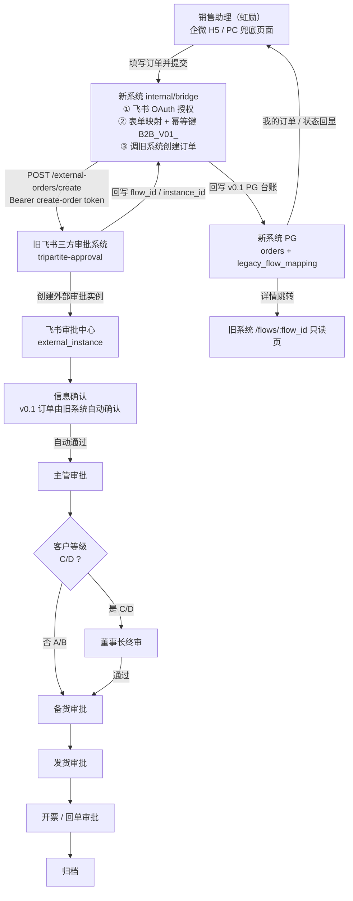
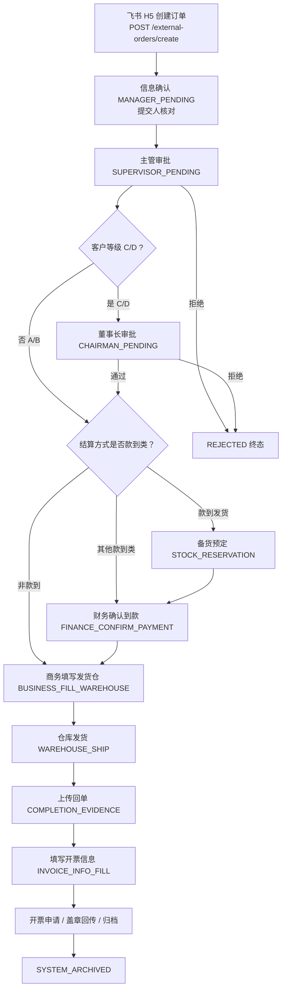
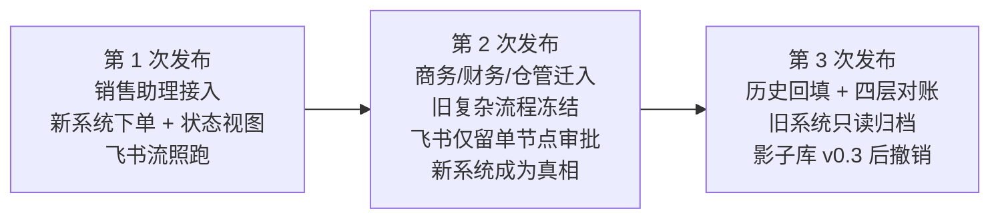
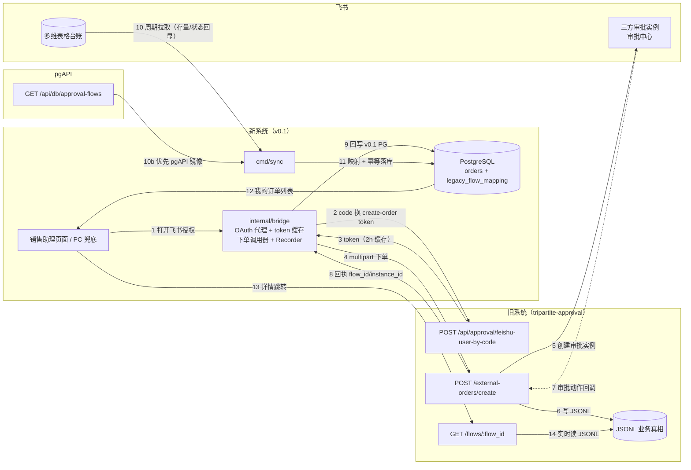
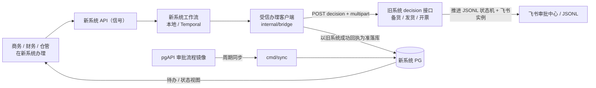

# 飞书兼容方案解释（基于当前文档与代码）

> 适用范围：b2b_pilot_v3（企微版订单履约系统）与 tripartite-approval（旧飞书三方审批系统）的兼容方案。
> 依据文档：`docs/发布计划/B2B_V01_对比与同步设计_20260818.md`、`docs/发布计划v2/渐进式发布计划v2.html`、`docs/gap-analysis.md`、`docs/v0.1/*`、`docs/v0.1/12-shadow-full-flow.html`、`spec/evidence/*`、`v0.2_设计_preview.html`、`v0.1发布后架构.html`。
> 依据代码：`internal/bridge/*`、`internal/api/bridge_handlers.go`、`internal/repo/bridge.go`、`cmd/sync/*`、`internal/sync/*`、`cmd/api/main.go`、`internal/shadow/*`、`internal/shadowguard/*`、`cmd/shadow-*`。
> 事实基线：本仓 `feat_v0.1 @ 7f4ec57`（影子代码 4e53763）；旧系统测试环境 `feat_v0.1 @ f3ed1f80 + e9505509/d7dcb649（信息确认自动确认豁免修复）`（2026-08-20）。

---

## 0. 结论摘要

“飞书兼容”并不是把飞书系统搬进新系统，而是让新企微版系统在迁移期与旧飞书三方审批流**共存、打通、渐进替换**。

核心模型：

> **第 1 次发布（v0.1） = 新系统只做“下单入口 + 订单列表/状态视图”，订单写进旧飞书审批流，后续审批由飞书流全权续跑；同时新增一条内部影子轨 S，用同一套代码在真实飞书数据上预演完整状态机。**

- 新系统通过桥接模块调用旧系统既有下单接口，让飞书审批中心出现标准审批待办。
- 审批人看到的订单、消息卡片、审批流与飞书 H5 下单完全一致，渠道透明、零感知。
- 新系统只回写自己的台账，并通过 `cmd/sync` 周期同步状态回显。
- 后续按 v0.2 最新讨论路线：旧飞书复杂流程冻结、新增极简单节点飞书流程 + 轻量飞书通道服务，逐步把执行动作和真相源迁到企微版新系统；v0.3 退化为历史回填 + 对账 + 归档。
- 影子轨（D-008..D-013）在 v0.1 期间按 D-012「新单实时增量」持续用真实数据验证状态机，产出覆盖率/分歧/对齐证据，作为 v0.2 数据迁入新系统（唯一真相）的 Go/No-Go 输入；影子库在 v0.3 企微体系发布完成后撤销。

---

## 1. 来龙去脉

### 1.1 旧系统现状

- 生产系统：`tripartite-approval`，Node/TS + JSONL 文件 + 飞书三方审批。
- 业务真相：16 个 JSONL 追加文件（orders / stock_prepares / shipments / invoices + 事件表）。
- 审批载体：飞书审批中心 `external_instance`。
- 对账副本：飞书多维表格（bitable）。
- 业务主流程：下单 → 信息确认 → 主管审批 → C/D 级董事长终审 → 备货 → 发货 → 开票/回单 → 归档。
- 财务、仓管、审批人都在飞书里工作，原流程不能停。

### 1.2 新系统目标

- 新系统：`b2b_pilot_v3`，Go + PostgreSQL + SpiceDB + Temporal + 企业微信。
- 最终目标：用企微版流程取代飞书三方审批流。
- 过渡策略：先让销售助理（虹励）用新系统，其他角色继续用飞书，原审批流不停。

### 1.3 方案演进

1. **早期设计（平行流）**
   - `docs/v0.1/11-migration.html` 曾设计：飞书 → 新系统单向只读同步，商务在新系统操作，但**不回写飞书**。
2. **方向反转（下单进飞书流）**
   - 用户明确需求：销售助手下单，后续业务流继续在飞书三方审批跑。
   - 于是新系统必须能把订单**写进**旧飞书审批流。
3. **当前定型方案**
   - `docs/发布计划/B2B_V01_对比与同步设计_20260818.md`
   - `docs/发布计划v2/渐进式发布计划v2.html`
4. **2026-08-20 双轨 + v0.2 路线刷新**
   - A 对外轨不变：销售助手下单进飞书流、状态回显。
   - S 影子轨随 v0.1 同发：`docker-compose.shadow.yml` 独立环境 + 自带 shadow-temporal，`internal/shadowguard` 六项 fail-fast，`shadow-ingest/feed/audit` 按 D-012 新单实时增量重演真实事件（JSONL/列表对账兜底）。
   - v0.2 采纳“旧复杂流程冻结 + 新增单节点飞书流程 + 新系统当真相”的讨论稿方向（见 `v0.2_设计_preview.html`）。

---

## 2. 业务流程（Mermaid）

### 2.1 第 1 次发布：销售助理下单 + 飞书审批续跑



**流程要点**：

- 新系统只做“下单入口 + 状态视图”。
- 订单创建走旧系统同一个 `POST /external-orders/create`，因此飞书侧审批人看到的是标准飞书审批流。
- 审批动作完全由飞书回调驱动，新系统不介入。
- “信息确认”节点通过旧系统对 `B2B_V01_` 前缀订单的自动确认逻辑，让销售助理在企微端无感。

### 2.2 旧系统原有飞书审批主流程（对照）



### 2.3 渐进式替换路线



---

## 3. 数据流（Mermaid）

### 3.1 第 1 次发布数据流



**数据流要点**：

- **写方向**：新系统 → 旧系统 `POST /external-orders/create` → 飞书审批实例 + JSONL，新系统只回写自己的台账。
- **读方向**：旧系统 JSONL → 多维表/pgAPI → `cmd/sync` 周期同步 → 新系统 PG → 用户列表/详情。
- **真相源**：第 1 次发布期间，旧系统 JSONL + 飞书审批实例是唯一真相；新系统 PG 只是可重建的视图/台账。
- **敏感边界**：`view_token` / `submitter_token` 不落新系统 PG，详情直接跳旧系统只读页。

#### 关于 PG 节点的动作说明

图中的 `PG["新系统 PG<br/>orders + legacy_flow_mapping"]` 对应的系统动作是 **“桥接回写轻量台账 + 旧流程映射”**，不是完整地写“流程结点信息 + 订单实体信息”。

对应代码：`internal/repo/bridge.go` 的 `RecordBridgeSubmission`。

##### 具体系统动作步骤

```text
1. 桥接客户端 CreateOrder 成功
   - 从旧系统 POST /external-orders/create 的 303 Location 拿到 instance_id
   - 轮询 GET /external-orders/submission-status 拿到 flow_id / stage_id / detail_url

2. 调用 Recorder.RecordSubmission(...)
   - 参数：tenantID, orderID, flowID, instanceID, stageID, detailURL

3. Repo.RecordBridgeSubmission 开启数据库事务

4. UPSERT orders 表（订单台账行）
   - 写入字段：
       id                 = orderID
       tenant_id          = tenantID
       customer_id        = 'bridge-customer'        -- 占位客户
       state              = 'ORD_REQUESTED'           -- 本系统初始状态
       payment_term       = '非款到'                  -- 台账视图统一口径
       supplier_channel   = ''
       idempotency_key    = 'B2B_V01_' + tenantID + ':' + orderID
       payload_hash       = hash(payload)
       payload            = {
                              "bridge_submission": true,
                              "flow_id": flowID,
                              "instance_id": instanceID,
                              "stage_id": stageID,
                              "detail_url": detailURL
                            }
       legacy_flow_id     = flowID
       submission_mode    = 'create'
   - 冲突处理：ON CONFLICT (tenant_id, idempotency_key)
       DO UPDATE SET legacy_flow_id, payload, payload_hash, updated_at

5. UPSERT legacy_flow_mapping 表（旧流程映射行）
   - 写入字段：
       tenant_id          = tenantID
       legacy_flow_id     = flowID
       legacy_stage_id    = stageID
       stage_code         = 从 stageID 尾部解析，如 'ORD'
       legacy_instance_id = instanceID
       target_type        = 'order'
       target_order_id    = orderID
   - 冲突处理：ON CONFLICT (tenant_id, stage_code, legacy_instance_id)
       DO UPDATE SET legacy_flow_id, legacy_stage_id, target_order_id, imported_at

6. 提交事务
   - 成功后，新系统 PG 中即可通过
       SELECT ... FROM orders
       WHERE tenant_id = ? AND legacy_flow_id IS NOT NULL
         AND payload->>'bridge_submission' = 'true'
     查询“我的订单”列表
```

##### 各表实际写入内容

| 表 | 实际写入内容 |
|---|---|
| `orders` | 桥接自建单台账行：订单 ID、租户、`state=ORD_REQUESTED`、`idempotency_key`、`legacy_flow_id`、`payload`（含 `flow_id/instance_id/stage_id/detail_url`）、`submission_mode=create` |
| `legacy_flow_mapping` | 旧流程映射行：`legacy_flow_id`、`legacy_stage_id`、`stage_code`（如 `ORD`）、`legacy_instance_id`、`target_type=order`、`target_order_id` |

##### 明确不写入

- 不写 `order_items` 商品明细；
- 不写 `order_events` 事件链；
- 不写 `approval_tasks` 审批节点/待办明细。

这是刻意设计：第 1 次发布中，新系统 PG 只承载“我的订单”列表和状态回显，**不承载审批执行**。商品明细、审批节点、状态机推进、事件链都在旧系统 JSONL + 飞书审批实例里。

### 3.2 第 2 次发布：受信办理通道数据流



---

## 4. 技术支撑点

### 4.1 复用旧系统既有接口，尽量不改旧系统

| 用途 | 旧系统接口 |
|---|---|
| 飞书授权换 token | `POST /api/approval/feishu-user-by-code` |
| 创建订单 + 审批实例 | `POST /external-orders/create`（multipart，303 重定向） |
| 查询提交结果 | `GET /external-orders/submission-status?key=...` |
| 只读详情页 | `GET /flows/:flow_id` |
| 后续执行迁移 | `POST /stock-prepares/:id/decision`、`/shipments/:id/decision`、`/invoices/:id/decision` |

### 4.2 OAuth 代理 + token 缓存

- 新系统用旧系统飞书应用的 `app_id` 构造授权 URL。
- `redirect_uri` 指向新系统回调端点。
- 新系统拿 `code` 调旧系统 `/api/approval/feishu-user-by-code` 换 `create-order token`。
- token 有效期 2 小时，新系统按用户缓存，过期前 15 分钟视为需要重新授权。
- 敏感身份 `open_id` 只用于调用旧系统，不落业务库。

### 4.3 幂等键 + 旧系统唯一小改

- 新系统生成幂等键：`B2B_V01_<tenant>:<orderID>`。
- 旧系统识别这个前缀后：
  1. 自动确认“信息确认”节点；
  2. 注入 `V01_SALES_ASSISTANT` profile，把主管/董事长审批路由到真实业务审批人。
- 这样避免虹励的订单卡在默认角色映射（王杰）上。
- 旧系统本身已有 `create_idempotency_key` + 指纹 + 文件锁，重复提交安全。

### 4.4 字段映射与单位对齐

- 新系统金额单位是“分”，旧系统是“元”，桥接时显式换算。
- 客户模式区分：
  - 老客户传 `customer_record_id`；
  - 新客户传名称/税号/等级等字段。
- 商品明细映射为 `items_json`。
- **结算方式必须对齐**：新系统“账期 30 天/月结 30 天”要映射成旧系统能识别的“款到发货/先款/款到/预付/现款/提货前付款”，否则会走错备货财务闸门。

### 4.5 读方向：存量订单同步（已裁决：v0.1 不做，归 v0.2 数据迁入）

- 新系统自建单直接查自己 PG（桥接回写）。
- 存量/历史订单通过 `cmd/sync` 拉取：
  - 优先拉 pgAPI 的 `/api/db/approval-flows`（稳定英文字段 + 分页）；
  - 也可用 JSONL 文件源兜底。
- 同步是**单向只读**，按列映射 + 敏感字段剥离 + `migration_batches` 幂等锚点，不影响飞书侧。
- 2026-08-20 已适配真实 JSONL 形态：决策事件无顶层 `flow_id` → `join_source` 按 `instance_id` 关联 `orders.jsonl`；嵌套 `detail` 对象 → FileFetcher 紧凑序列化（同能力复用于 shadow-ingest）。

### 4.6 敏感边界

- `view_token`、`submitter_token` 不进新系统 PG。
- 新系统只存 `flow_id` / `instance_id` / `detail_url`。
- 详情页直接跳旧系统 `/flows/:flow_id`，该页无鉴权只读，符合迁移安全边界。

### 4.7 受信办理通道（第 2、3 次发布共用）

- 已验证旧系统 decision 接口只校验 `approver_token`，无飞书身份依赖。
- 后续新系统办理动作通过受信通道写回旧系统：
  - 需要补“真实操作人”字段；
  - 需要加幂等锁，防止新系统 + 飞书残留待办并发办理。

### 4.8 回滚与兜底

- 新系统关闭 `B2B_FEISHU_BRIDGE_ENABLED` 即停用下单，旧系统零回滚。
- v0.1 订单与旧系统数据共存同一 JSONL，按 `approval_profile` / `flow_id` 区分。

---

## 5. 关键系统组件

### 5.1 新系统侧（本仓库已实现）

| 组件 | 作用 |
|---|---|
| `internal/bridge` | 飞书 OAuth 代理、token 缓存、下单调用器、错误分类、幂等键生成 |
| `internal/api/bridge_handlers.go` | 提供桥接 API |
| `internal/repo/bridge.go` | 桥接下单回写 PG、我的订单台账查询 |
| `internal/api/bridge_ui.html` | PC 兜底下单/订单列表页 |
| `internal/api/assistant_ui.html` | 销售助理企微 H5/PC 页面（代下单 + 飞书授权） |
| `cmd/sync` + `internal/sync` | 飞书/pgAPI 数据只读同步 Job |
| `cmd/api/main.go` | 桥接配置装配（`B2B_FEISHU_BRIDGE_*` 环境变量） |

### 5.2 新系统 API 端点

```text
GET  /api/v1/bridge/auth-url       # 生成飞书授权 URL
POST /api/v1/bridge/callback       # OAuth code 换 token
POST /api/v1/bridge/orders         # 下单进飞书流
GET  /api/v1/bridge/orders         # 我的订单列表
GET  /bridge                       # PC 兜底页面
GET  /assistant                    # 销售助理页面
```

### 5.3 旧系统侧（外部依赖，尽量零改动）

| 组件 | 作用 |
|---|---|
| `POST /external-orders/create` | 创建订单 + 飞书审批实例 |
| `/api/approval/feishu-user-by-code` | code 换 create-order token |
| `/external-orders/submission-status` | 查询 flow_id / instance_id |
| `/flows/:flow_id` | 只读全流程详情页 |
| `approval_role_map.json` | 审批人角色映射 |
| `agent_person_map.json` / `sales_person_map.json` | 下单白名单 |
| JSONL 文件 | 生产真相 |
| 飞书多维表格 | 对账副本 |

---

## 6. 当前落地状态与注意点

**2026-08-20 最新落地状态**（本仓 `7f4ec57` + 测试服务器实况）：

- 测试环境已关闭原直接阻塞：R-01 基线（pilot_v3@85eb85d → /opt/pilot_v3；旧系统 f3ed1f80 → 121.43.58.1:3002）；R-02 api 28080 healthy、`auth-url` 200、业务库/seedrel 就绪、pgAPI 测试（pgapi-test / carh_test 备库）已接通；R-03/D-09 V01 档（审批=王杰、业务=马弘毅，open_id 0 跨应用）；R-04 `B2B_V01_` 自动确认小改已部署并推送 f3ed1f80；R-05 飞书白名单 4 URL、网页授权通过、企微 official（agent 1000007）双签名就绪；**R-08 备库 b2b-replica:25433 已搭建并 promote、全项目已切备库（override f3592ea）、sync 已灌 5,214 条真实订单（cfdad13）、backfill dry-run 空跑确认无源数据（O-08 测试环境不适用）**。
- 部分进展：R-06 真实授权链路已通，完整下单闭环待约虹励（另：SO-20260820-0012 主管审批的信息确认误拦截已修复——旧系统 e9505509/d7dcb649 事件特征兜底）；R-09 PC 兜底全 200，正式回退口径待拍板。
- 生产仍 No-Go：R-10 UAT/Go-No-Go、R-07 新窗口。
- 影子轨：代码已全部提交（D-008..D-013：D-012=新单实时增量、D-013=v0.1 桥接闭环+影子硬口径；internal/shadow、shadowguard、008 迁移、独立 compose、三命令、写哨兵）；本地全栈预演 8 事件 → INV_CLOSED、audit 21/79、0 分歧；HR1 真实 status 映射基线与 JSONL 适配已完成待业务签字；HR2 pgAPI 只读凭据未决。

所以“飞书兼容”在**代码和方案层面已经成立且已提交**，但真正上线还需要完成：R-06/R-10、影子 HR1 签字与 HR2 凭据、R1→R2 发布门禁。

---

## 7. 影子系统与飞书兼容的关系（2026-08-20）

影子轨不是“另一套飞书对接”，而是**用飞书真实数据验证新系统完整状态机**的内部预演：

| 问题 | 答案 |
|---|---|
| 数据从哪来？ | 真实 JSONL/pgAPI 只读源（5 源示例：orders / order_events / stock_prepare_events / shipment_events / invoice_events） |
| 怎么翻译？ | `config/shadow-feed.example.json` 35 条真实 status 规则（按 f3ed1f80 代码事实生成）：`ORDER_SUBMIT_ACCEPTED → start`、`SUPERVISOR_APPROVED → price-review`、`CHAIRMAN_SKIPPED / CONTRACT_STUB_CREATED → ignore` 等；未知动作只写 `UNMAPPED_EVENT`，绝不猜测 |
| 怎么跑？ | 影子模式 `Shadow=true`：Timer 全抑制，由 `SignalShadowInject` 注入与 Timer 等价的分支；同一 WorkflowID 重放用 `AllowDuplicate + TerminateExisting` |
| 会不会影响生产飞书？ | 不会：独立 compose 项目、自带 shadow-temporal、影子容器对 A 轨主机名零可达；`B2B_WECOM_PROVIDER=mock`、`B2B_FEISHU_BRIDGE_ENABLED=false`；写哨兵校验生产库 `shadow_*` 零存在 |
| 对 v0.2/v0.3 有什么用？ | 覆盖率/分歧/状态对齐成为 v0.2 数据迁入新系统（唯一真相）Go 证据（SH-12：连续 7 日审计）；v0.3 企微体系发布完成后影子库归档 → 停栈 → drop |
| 剩余外部输入 | HR1：35 条规则业务逐条签字 + detail 字段名 T1.3 冻结；HR2：pgAPI 只读 key + 真实响应样例 + 写接口被拒证据；A13：影子驱动源推荐“影子侧种子” |

---

## 8. 一句话总结

> 飞书兼容的本质是：**v0.1 新系统“借道”旧系统下单接口，把订单写进飞书三方审批流，审批继续在飞书跑，新系统只做下单入口和状态视图；影子轨用同一套代码在真实飞书数据上预演完整状态机；v0.2 起旧复杂流程冻结、飞书退化为单节点审批渠道，新系统成为真相；v0.3 只做历史回填、对账与归档，最终飞书整体下线。**
